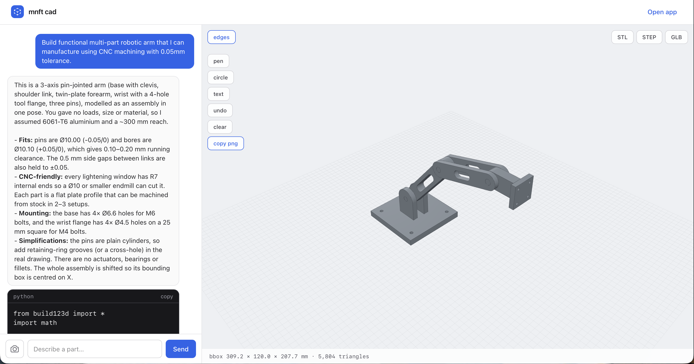
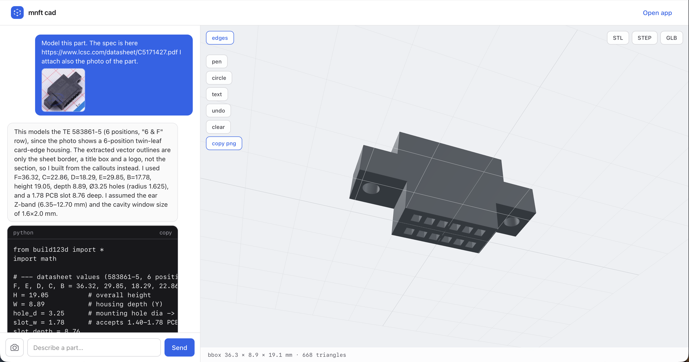
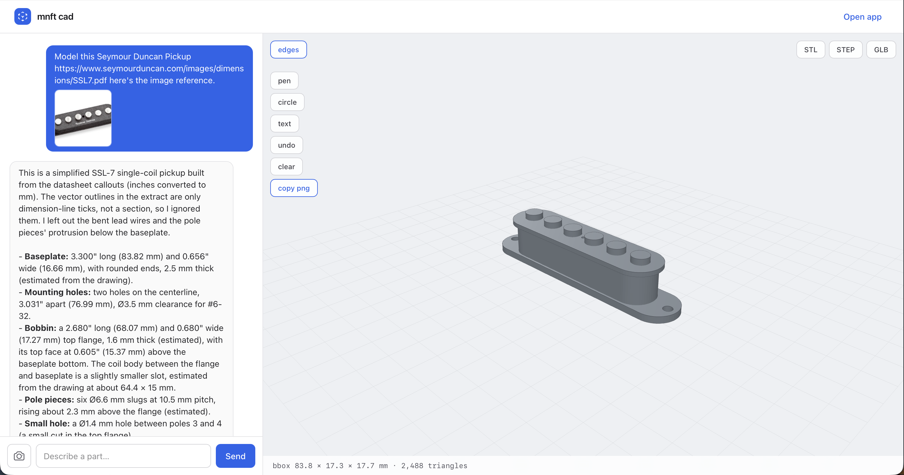

# mnft



Say it out loud and your mouth already knows the word: manufacture.

The word started life as Latin *manu factus*, made by hand. It travelled far
and refused to change much along the way. The English say manufacture, the
Estonians manufaktuur, the Indonesians manufaktur. Germans kept Manufaktur,
the French manufacture, Italians manifattura, Spaniards manufactura, and the
Portuguese trimmed it to manufatura. You will hear manufactuur in Dutch,
manufaktur in Swedish, manufaktuuri in Finnish, manufaktura in Polish, and
мануфактура in Russian. Different alphabets, same idea, and the same four
letters hiding in every single one of them: m, n, f, t.

That idea was making things by hand. This project keeps the making and hands
the manual labour to something else. You describe a part in plain language.
A language model writes CAD code. A guarded engine runs it, and you get an
STL, a STEP file, and a 3D preview you can turn around in your browser.
Made by prompt, checked by machine, downloaded in the formats a machine shop
actually wants.

Everything here is open source, Apache-2.0.

```
mnft_cad/       the core. Turn pipeline, pluggable engines (build123d,
                OpenSCAD), pluggable storage (an ETS table backed by an
                fsynced journal by default), BYO-key multi-provider LLM.
                Pure Elixir/OTP: it ships without a web framework, an auth
                layer, or a database server.
mnft_cad_web/   a reference Phoenix app. Chat UI, 3D viewer, anonymous cookie
                owner. Run it and see.
mnft_cad_headless/
                a headless reference: the core with the UI stripped away,
                running many owners, many sessions, and all turns at once.
cad_worker/     a small Python CLI that runs build123d code behind static
                checks, rlimits and a hard wall clock. The build123d
                engine's runtime.
```

## Try it

Requirements:

- Elixir 1.17+ (with Erlang/OTP)
- Python 3.11 or 3.12, with [uv](https://docs.astral.sh/uv/)
- An LLM API key
- *Optional:* [poppler](https://poppler.freedesktop.org/), only if you paste
  PDF datasheet links into prompts. Neither `mix` nor `uv` installs it.
  `brew install poppler` (macOS) or `apt install poppler-utils` (Debian/Ubuntu).
  Without it everything else works, but PDFs are not read.

```bash
cd cad_worker && uv venv --python 3.12 && uv pip install -e . pytest && cd ..
cp .env.example mnft_cad_web/.env      # then add your LLM_API_KEY
cd mnft_cad_web && mix setup
mix phx.server                            # http://localhost:4200
```

```bash
# no UI?
cd mnft_cad_headless && mix deps.get && MNFT_HEADLESS_FAKE=1 mix run -e "MnftCadHeadless.run()"
```

### With Docker

No Erlang, Python or poppler needed on your machine. The image is a `mix
release` of the reference web app (`mnft_cad_web`) plus the build123d worker —
no code reloader, no asset watchers, no `mix` at runtime.

```bash
docker build -t mnft .
docker run --rm -p 4000:4000 -e LLM_API_KEY=sk-... mnft    # http://localhost:4000
```

Pass any other setting from `.env.example` with `-e` or `--env-file`, for
example `-e LLM_PROVIDER=anthropic -e LLM_BASE_URL=`. Generated models and the
journal live in `/data` and vanish with the container; add
`-v mnft-data:/data` to keep them. For a long-lived deployment also set
`SECRET_KEY_BASE` (without it a random key is generated per boot and saved
parts become unreachable after a restart) and `PHX_HOST` when the app sits
behind a proxy. The caution at the end of this README still applies: none of
this is a sandbox.

The engine choice is one line of config. The default is **build123d** (full
fidelity, STEP included, runs through cad_worker with the OpenCascade wheels).
If you would rather not install a gigabyte of OpenCascade wheels, switch to the
**OpenSCAD** engine: one forty-megabyte binary, everything else done in pure
Elixir. OpenSCAD produces meshes only — STL and GLB but never STEP. It is the
3D-printing path; build123d covers machining.

A third engine, **smlibpy** (new/alpha), uses the SMLib NURBS kernel by
[AWV Informatik AG](https://github.com/awv-informatik/smlibpy) (MIT licence).
It ships as a small (~7 MB) manylinux wheel for Python 3.10–3.14, needs no
OpenCascade, and supports STEP/STL/GLB at full B-rep fidelity. Install the
optional extra and flip the env variable:

```bash
cd cad_worker && uv pip install -e ".[smlibpy]"
# then set MNFT_ENGINE=smlibpy
```

smlibpy is new here and has had less production time than build123d. Treat it
as a second option, not a replacement.

## Examples

Three real turns from the reference web app: the ask, then what the code
built.

**A CNC-machined robotic arm, asked for in plain language.**



**A TE 583861-5 card-edge connector, from a datasheet URL and a photo.**



**A Seymour Duncan SSL-7 single-coil pickup, from its spec sheet.**



Your results will differ: the CAD that comes back depends on the LLM you
bring, and models write build123d and OpenSCAD with different skill.
Experiment. Swapping `LLM_PROVIDER` or `LLM_TEXT_MODEL` is one line of
config, and sometimes that is all a tricky part needs.

## Building on the core

`mnft_cad/README.md` has the embedding guide. The short version: the core
never asks who you are. You hand it an opaque owner id, your choice of
storage adapter, your choice of engine, and an event handler to carry
progress wherever you want. API keys come with a resolver callback, so you
can keep them wherever your host keeps secrets. Provider, endpoint and
models are config only.

Environment variables, if you just want to run it: `LLM_API_KEY`,
`LLM_BASE_URL`, `LLM_TEXT_MODEL`, `LLM_VISION_MODEL`, `LLM_TIMEOUT_S`,
`CAD_WORKER_PYTHON`, `CAD_WORKER_CWD`, `OPENSCAD_BIN`, `MNFT_DATA_DIR`.
Set `LLM_PROVIDER=anthropic` and leave `LLM_BASE_URL` empty for Claude models.

## Tests

```bash
cd cad_worker && .venv/bin/python -m pytest -q
cd mnft_cad && mix test
cd mnft_cad_web && mix test
```

CI runs all three on Linux and macOS.

## Acknowledgement

This project is designed, built, and maintained by [Nanas Sound](https://www.nanas.ee) using AI
coding agents. The commits tell the truth: most of the code was written in
conversation, reviewed by a human, and shipped the same day. Fitting, for a
tool about describing things in plain language and getting real objects back.

## A word of caution

The engines run code a language model wrote. The worker puts real fences
around it: static gates, restricted interpreter, memory and CPU limits, a
wall clock, and a process-group kill when time runs out. That protects you
from mistakes and prompt slips. It is still not a sandbox. Run it locally or
behind your own auth, and if you ever expose it to strangers, put
kernel-level isolation between them and the worker first.
